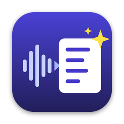

<div align="center">



<h1>Meeting Notes AI</h1>

<p><strong>Meetings und Sprachmemos transkribieren, zusammenfassen und mit KI sauber nachbearbeiten – auf dem Mac.</strong></p>

<p>
  
  
  
  
</p>

</div>

Meeting Notes AI ist ein Fork von [Soufflé](https://github.com/damione1/souffle) von Damien Goehrig.
Soufflé nimmt Meetings auf, trennt „Ich“ und „Andere“, transkribiert lokal (Kyutai, Whisper, Parakeet, Apple Speech)
und fasst mit Entscheidungen, Aufgaben und offenen Fragen zusammen. Meeting Notes AI behält all das
und ergänzt:

## Neu in Meeting Notes AI

### Ollama Cloud (z. B. DeepSeek) – ohne lokales Ollama
- In **Einstellungen → KI** den Schalter **„Ollama Cloud“** einschalten und den API-Schlüssel von
  [ollama.com/settings/keys](https://ollama.com/settings/keys) einfügen.
- Der Schlüssel liegt im **macOS-Schlüsselbund** (Dienst „Meeting Notes AI“), nie in der Datenbank.
  Er wird nur an `https://ollama.com` gesendet.
- Das Modell (z. B. DeepSeek) wählst Du aus der Liste, die direkt von Ollama Cloud kommt.
- Ein lokales Ollama bleibt weiter möglich: Schalter aus, und die bisherige Adresse und das bisherige
  Modell werden wiederhergestellt.
- **Datenschutz:** Mit Ollama Cloud geht der Transkripttext an Ollama. Transkription und Audio bleiben
  immer lokal.

### Bereinigtes Transkript neben dem Original
- Auf der Meeting-Seite schaltest Du zwischen **Original | Bereinigt | Vergleich** um.
- Die KI korrigiert Rechtschreibung, Grammatik und Füllwörter absatzweise. Sie erfindet nichts:
  Fehlt eine Antwort oder ist sie unplausibel, bleibt das Original stehen und wird markiert.
- **Vergleich** zeigt Wort für Wort, was entfernt (rot) und was ergänzt (grün) wurde.
- Jeder Absatz lässt sich von Hand bearbeiten. Das Original wird nie verändert.
- Export (Markdown/JSON) und Archiv enthalten beide Fassungen.

### Sprachmemos und Audiodateien importieren
- Auf der Startseite: **„Audiodatei importieren …“** (Mehrfachauswahl möglich).
- Formate: m4a (iPhone-/Mac-Sprachmemos), mp3, wav, flac, ogg.
- Die Datei wird mit dem eingestellten Modell transkribiert (für Deutsch: Whisper) und erscheint als
  normales Meeting im Verlauf. Danach Zusammenfassung und Bereinigung wie bei jeder Aufnahme.
- Das Audio wird mitgespeichert, wenn in den Einstellungen die Audio-Aufbewahrung eingeschaltet ist.
- Auch auf der Kommandozeile: `--transcribe-file memo.m4a`.

### Deutsch
- Deutsche Meetings werden auf Deutsch zusammengefasst.

## Voraussetzungen

- Mac mit Apple-Chip, macOS 13 oder neuer (Systemton in Meetings ab macOS 14.4).
- Speicherplatz für das Sprachmodell (ca. 0,7–2,4 GB).
- Für Zusammenfassung und Bereinigung: Ollama Cloud (API-Schlüssel), ein lokales
  [Ollama](https://ollama.com/) oder Apple Intelligence (macOS 26).

## Selbst bauen

Benötigt [Rust](https://rustup.rs/), die Xcode-Kommandozeilenwerkzeuge und `cmake` (`brew install cmake`).

```bash
git clone https://github.com/chrispil1337/meeting-notes-ai.git
cd meeting-notes-ai
make nightly
```

`make nightly` baut und öffnet **Meeting Notes AI Nightly** mit eigenen Daten und Berechtigungen.
Eine Schritt-für-Schritt-Anleitung steht in [docs/ANLEITUNG.md](docs/ANLEITUNG.md).

## Eigene Daten

Meeting Notes AI hat eine eigene Bundle-ID (`com.meetingnotesai.desktop`) und damit einen eigenen
Datenordner (`~/Library/Application Support/com.meetingnotesai.desktop`). Es läuft neben einem
installierten Soufflé und greift nicht auf dessen Daten zu.

## Mehr Details

Die ausführliche Beschreibung der übernommenen Soufflé-Funktionen (Diktat, Modelle, Berechtigungen,
Netzwerkzugriffe, MCP-Server) steht in [docs/SOUFFLE-README.md](docs/SOUFFLE-README.md).

## Lizenz

GPL-3.0-or-later, wie Soufflé. Siehe [LICENSE.md](LICENSE.md) und [NOTICE](NOTICE).
